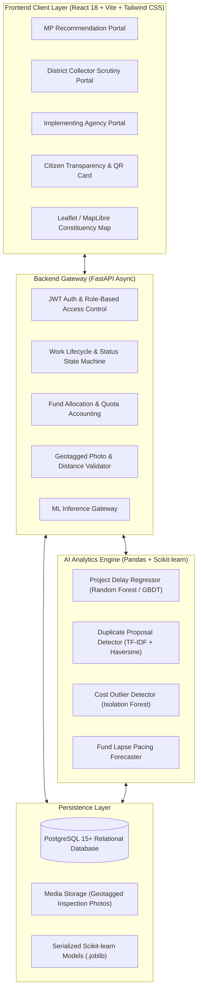

# MPLAD-AI
AI-Powered MPLADS Monitoring System

[](https://www.sih.gov.in/)
[](https://www.sih.gov.in/)
[](https://fastapi.tiangolo.com/)
[](https://react.dev/)
[](https://scikit-learn.org/)
[](https://www.postgresql.org/)

---

## 📌 Project Overview
**MPLAD-AI** is an AI-powered intelligence, monitoring, and accountability platform designed for the **Members of Parliament Local Area Development Scheme (MPLADS)** under the Ministry of Statistics and Programme Implementation (**MoSPI**), developed for **Smart India Hackathon 2026 (Problem Statement ID: 26102)**.

The system addresses critical systemic inefficiencies in the execution of public community assets:
1. **Prolonged Work Execution & Sanction Latency**: AI-driven delay prediction models identify high-risk projects before ground execution begins.
2. **Duplicate & Overlapping Asset Detection**: Dual-stage NLP (TF-IDF) and geospatial (Haversine radial) matching prevent duplicate fund allocation for assets already existing or funded under other schemes (PMGSY, Jal Jeevan Mission, etc.).
3. **Cost Anomaly & SOR Variance Detection**: Scikit-learn Isolation Forests benchmark submitted estimates against Schedule of Rates (SOR) to detect over-budgeting.
4. **Demographic Quota Compliance**: Automated real-time tracking of statutory allocations (15% Scheduled Caste, 7.5% Scheduled Tribe).
5. **Geotagged Anti-Spoofing Inspections**: Enforces radius verification between on-site inspection photos and registered project coordinates.
6. **Public Transparency & Citizen Grievance Portal**: Open transparency portal allowing citizens to inspect developmental works, view before/after geotagged photos, and submit feedback.

---

## 🏗️ System Architecture



---

## 👥 6-Member Team Structure & Responsibilities

| Role | Member Focus | Key Deliverables |
| :--- | :--- | :--- |
| **Member 1 (Lead)** | System Architect & Full-Stack Lead | Monorepo orchestration, FastAPI gateway, Docker Compose, RBAC, CI/CD |
| **Member 2** | Frontend Lead | React 18, Vite, Tailwind CSS, MP Recommendation & Collector Scrutiny portals |
| **Member 3** | Frontend & GIS Specialist | Interactive Leaflet GIS map, citizen transparency portal, QR asset cards |
| **Member 4** | Backend & Database Specialist | PostgreSQL schema, SQLAlchemy 2.0 ORM, Alembic migrations, CRUD services, audit trail |
| **Member 5** | ML Engineer 1 (Predictive Analytics) | Delay prediction regressor, fund lapse forecaster, Pandas feature pipelines |
| **Member 6** | ML Engineer 2 (Anomaly & Duplicate) | TF-IDF + spatial duplicate detector, cost outlier Isolation Forest, sector classifier |

---

## 📂 Repository Structure

```
MPLAD-AI/
├── README.md               # Main Project Overview & Architecture Guide
├── .gitignore              # Multi-stack gitignore (Python, Node, Vite, env)
├── docker-compose.yml      # Multi-service local orchestrator (App, DB, ML)
├── docs/                   # Complete System Specifications
│   ├── ARCHITECTURE.md     # System layers, data flow & security architecture
│   ├── PHASED_PLAN.md      # Sprint roadmap for the 6-member team
│   ├── DATA_SCHEMA.md      # PostgreSQL DDL, ER diagram, indices & constraints
│   ├── API_CONTRACTS.md    # FastAPI REST specifications & JSON schemas
│   ├── TEAM_WORKFLOW.md    # Git branching, commit standard & PR policies
│   └── ML_SPECIFICATION.md # Scikit-learn model specifications & metrics
├── backend/                # FastAPI application
├── frontend/               # React + Vite + Tailwind CSS application
└── ml_engine/              # Scikit-learn training & data exploration lab
```

---

## 📚 Technical Documentation Index

Detailed architectural specifications are available in the [docs/](file:///C:/Users/Asuus/MPLAD-AI/docs) directory:
- [System Architecture](file:///C:/Users/Asuus/MPLAD-AI/docs/ARCHITECTURE.md)
- [Phased Implementation Roadmap](file:///C:/Users/Asuus/MPLAD-AI/docs/PHASED_PLAN.md)
- [Shared Data Schema (PostgreSQL DDL)](file:///C:/Users/Asuus/MPLAD-AI/docs/DATA_SCHEMA.md)
- [API Contracts & Interfaces](file:///C:/Users/Asuus/MPLAD-AI/docs/API_CONTRACTS.md)
- [Git Branching & Team Workflow](file:///C:/Users/Asuus/MPLAD-AI/docs/TEAM_WORKFLOW.md)
- [Machine Learning Specification](file:///C:/Users/Asuus/MPLAD-AI/docs/ML_SPECIFICATION.md)

---

## 🛠️ Tech Stack Matrix

| Tier | Technology | Key Packages |
| :--- | :--- | :--- |
| **Frontend** | React 18, Vite 5, Tailwind CSS | `react-router-dom`, `@tanstack/react-query`, `lucide-react`, `leaflet`, `recharts` |
| **Backend** | FastAPI, Python 3.11+ | `pydantic-v2`, `sqlalchemy-2.0`, `alembic`, `asyncpg`, `python-jose`, `passlib` |
| **Database** | PostgreSQL 15+ | Relational schema with spatial indices, PostGIS-compatible |
| **Machine Learning** | Scikit-learn, Pandas, NumPy | `scikit-learn`, `pandas`, `numpy`, `scipy`, `joblib` |
| **DevOps** | Docker, Docker Compose | Multi-stage production and development container builds |

---

## 🚀 Getting Started (Planned Development Workflow)

### Prerequisites
- Node.js 18+ & npm
- Python 3.11+
- PostgreSQL 15+ (or Docker Desktop)

### 1. Clone the Repository
```bash
git clone https://github.com/ManasPatel0/MPLAD-AI.git
cd MPLAD-AI
```

### 2. Backend Setup
```bash
cd backend
python -m venv .venv
source .venv/bin/activate  # On Windows: .venv\Scripts\activate
pip install -r requirements.txt
uvicorn app.main:app --reload --port 8000
```
Interactive API documentation will be available at `http://localhost:8000/docs`.

### 3. Frontend Setup
```bash
cd ../frontend
npm install
npm run dev
```
Client application will run at `http://localhost:5173`.
