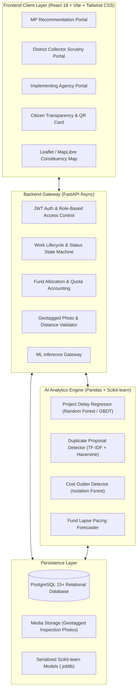

# MPLAD-AI
AI-Powered MPLADS Monitoring System

[](https://www.sih.gov.in/)
[](https://www.sih.gov.in/)
[](https://fastapi.tiangolo.com/)
[](https://react.dev/)
[](https://scikit-learn.org/)
[](https://www.postgresql.org/)

---

## 📌 Project Overview
**MPLAD-AI** is an AI-powered intelligence, monitoring, and accountability platform designed for the **Members of Parliament Local Area Development Scheme (MPLADS)** under the Ministry of Statistics and Programme Implementation (**MoSPI**), developed for **Smart India Hackathon 2026 (Problem Statement ID: 26102)**.

The system addresses critical systemic inefficiencies in the execution of public community assets:
1. **Prolonged Work Execution & Sanction Latency**: AI-driven delay prediction models identify high-risk projects before ground execution begins.
2. **Duplicate & Overlapping Asset Detection**: Dual-stage NLP (TF-IDF) and geospatial (Haversine radial) matching prevent duplicate fund allocation for assets already existing or funded under other schemes (PMGSY, Jal Jeevan Mission, etc.).
3. **Cost Anomaly & SOR Variance Detection**: Scikit-learn Isolation Forests benchmark submitted estimates against Schedule of Rates (SOR) to detect over-budgeting.
4. **Demographic Quota Compliance**: Automated real-time tracking of statutory allocations (15% Scheduled Caste, 7.5% Scheduled Tribe).
5. **Geotagged Anti-Spoofing Inspections**: Enforces radius verification between on-site inspection photos and registered project coordinates.
6. **Public Transparency & Citizen Grievance Portal**: Open transparency portal allowing citizens to inspect developmental works, view before/after geotagged photos, and submit feedback.

---

## 🏗️ System Architecture



---

## 👥 6-Member Team Structure & 30-Subtask Breakdown

The system modules are strictly aligned with the official MoSPI Problem Statement 26102 Flowchart, assigning **1 Master Task and 5 Subtasks to each of the 6 team members**:

| Member | Role | Flowchart Domain | Key Deliverable |
| :--- | :--- | :--- | :--- |
| **Member 1 (Leader)** | System Architect & Backend Lead | 1. Data Sources, 2. Ingestion & Storage, API Gateway | FastAPI Gateway, Docker, Neon/PostgreSQL Schema, RBAC |
| **Member 2** | Data Preprocessing Specialist | 3. Data Preprocessing & Feature Engineering | Cleaning Pipelines, Source Merging, Feature Matrix Parquet |
| **Member 3** | ML Engineer 1 (Detection Specialist)| 4. Analysis & Detection Modules | Cost, Delay, Duplicate (NLP+Geo) & Payment Anomaly Models |
| **Member 4** | ML Engineer 2 (Risk & Explainable AI)| 5. Risk Scoring & 8. Feedback Loop | 0-100 Hybrid Risk Engine, XAI Reasoning, Remedial Actions |
| **Member 5** | Frontend Lead (Dashboards & Reports) | 6. Web Application (KPIs, Explorer, Analytics, Exports) | React 18, Vite, Summary KPIs, Multi-Filters, PDF Export |
| **Member 6** | Frontend & GIS Specialist (Maps & Dossier)| 6. India GIS Map, Detailed Project Dossier & XAI Views | Interactive Leaflet Map, Flagged Heatmap, Project Dossier |

> 📖 **Full Task Specification:** See [docs/TEAM_TASK_ALLOCATION.md](docs/TEAM_TASK_ALLOCATION.md) for the complete checklist of all 30 subtasks, data schemas, inputs, outputs, and dependencies.

---

## 📂 Repository Structure

`
MPLAD-AI/
├── README.md                   # Main Project Overview & Architecture Guide
├── .gitignore                  # Multi-stack gitignore (Python, Node, Vite, env)
├── docker-compose.yml          # Multi-service local orchestrator (App, DB, ML)
├── docs/                       # Complete System Specifications
│   ├── TEAM_TASK_ALLOCATION.md # 6-member team breakdown (5 subtasks each)
│   ├── ARCHITECTURE.md         # System layers, data flow & security architecture
│   ├── PHASED_PLAN.md          # Sprint roadmap for the 6-member team
│   ├── DATA_SCHEMA.md          # PostgreSQL DDL, ER diagram, indices & constraints
│   ├── API_CONTRACTS.md        # FastAPI REST specifications & JSON schemas
│   ├── TEAM_WORKFLOW.md        # Git branching, commit standard & PR policies
│   └── ML_SPECIFICATION.md     # Scikit-learn model specifications & metrics
├── backend/                    # FastAPI application & Neon PostgreSQL connection
│   ├── app/
│   │   ├── api/v1/             # REST endpoints (health, projects, risk, analytics)
│   │   ├── core/               # config.py (Neon URL auto-normalizer), database.py
│   │   └── main.py             # FastAPI entrypoint
│   └── tests/                  # Health & Neon database mock unit tests
├── frontend/                   # React + Vite + Tailwind CSS application
│   ├── src/                    # Components, pages, GIS maps, charts
│   └── package.json
└── ml_engine/                  # ML & Data Science Lab
    ├── preprocessing/          # Member 2: Cleaning & feature engineering
    ├── detection/              # Member 3: Cost, delay, duplicate & payment modules
    ├── risk_engine/            # Member 4: Hybrid 0-100 risk scoring & XAI
    └── saved_models/           # Serialized model artifacts (.joblib)
`

---

## 📚 Technical Documentation Index

Detailed architectural specifications are available in the [docs/](docs) directory:
- [6-Member Team Task Allocation (30 Subtasks)](docs/TEAM_TASK_ALLOCATION.md)
- [System Architecture](docs/ARCHITECTURE.md)
- [Phased Implementation Roadmap](docs/PHASED_PLAN.md)
- [Shared Data Schema (PostgreSQL DDL)](docs/DATA_SCHEMA.md)
- [API Contracts & Interfaces](docs/API_CONTRACTS.md)
- [Git Branching & Team Workflow](docs/TEAM_WORKFLOW.md)
- [Machine Learning Specification](docs/ML_SPECIFICATION.md)

---

## 🛠️ Tech Stack Matrix

| Tier | Technology | Key Packages |
| :--- | :--- | :--- |
| **Frontend** | React 18, Vite 5, Tailwind CSS | `react-router-dom`, `@tanstack/react-query`, `lucide-react`, `leaflet`, `recharts` |
| **Backend** | FastAPI, Python 3.11+ | `pydantic-v2`, `sqlalchemy-2.0`, `alembic`, `asyncpg`, `python-jose`, `passlib` |
| **Database** | PostgreSQL 15+ | Relational schema with spatial indices, PostGIS-compatible |
| **Machine Learning** | Scikit-learn, Pandas, NumPy | `scikit-learn`, `pandas`, `numpy`, `scipy`, `joblib` |
| **DevOps** | Docker, Docker Compose | Multi-stage production and development container builds |

---

## 🚀 Getting Started & Local Development (Phase 1)

### Prerequisites
- **Python**: 3.11+ (Python 3.14 compatible)
- **Node.js**: 18+ (Node 20+ recommended) & npm
- **Database**: PostgreSQL 15+ (Optional in Phase 1; backend includes non-blocking diagnostic probes)

---

### Windows PowerShell Quickstart

#### 1. Backend Setup (FastAPI Gateway)
Open a PowerShell terminal:
```powershell
# Navigate to backend directory
cd backend

# Create and activate Python virtual environment
python -m venv .venv
.\.venv\Scripts\Activate.ps1

# Copy environment variables template
Copy-Item .env.example .env

# Install backend dependencies
pip install -r requirements.txt

# Run Phase 1 Health Endpoint Tests
python -m unittest tests/test_health.py
# Or with pytest:
# pytest

# Start FastAPI development gateway
uvicorn app.main:app --reload --port 8000
```
- Interactive Swagger OpenAPI Docs: `http://localhost:8000/docs`
- Health Check Endpoint: `http://localhost:8000/api/v1/health`

#### 2. Frontend Setup (React + Vite + Tailwind CSS)
Open a second PowerShell terminal:
```powershell
# Navigate to frontend directory
cd frontend

# Copy environment variables template
Copy-Item .env.example .env

# Install dependencies
npm install

# Run TypeScript compilation and production build check
npm run build

# Start Vite development server
npm run dev
```
- Access the Executive Monitoring Portal at `http://localhost:5173`.
- The dashboard automatically pings `GET /api/v1/health` and displays the live status badge.

---

### 🧪 Verification & Health Check Results (Phase 1)
- **Backend Health Tests**: Run `python -m unittest tests/test_health.py` (4 passing tests verifying `/`, `/api/v1/health`, payload contracts, and 404 standard errors).
- **Frontend Build Verification**: Run `npm run build` in `frontend` (TypeScript `tsc` compiles clean, Vite bundles production assets in `< 5s`).
