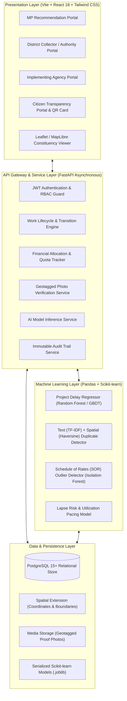
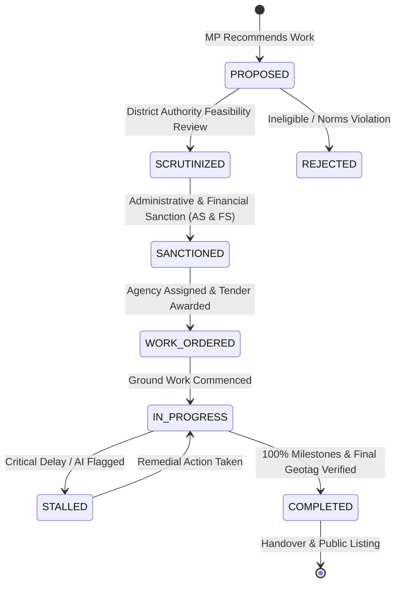

# MPLAD-AI: System Architecture Specification
**Smart India Hackathon 2026 | Problem Statement ID: 26102**
**AI-Powered MPLADS Monitoring & Accountability System**

---

## 1. System Overview

MPLAD-AI is an end-to-end monitoring, anomaly detection, and predictive management platform for the Members of Parliament Local Area Development Scheme (MPLADS). It transforms the recommendation, sanction, execution, and verification lifecycle of developmental works through automated intelligence, GIS tracking, and citizen verifiability.

---

## 2. Layer Responsibilities & Technical Decisions

### 2.1 Frontend Client Layer (React 18 + Vite + Tailwind CSS)
- **Role-Based Portals**:
  - **MP Portal**: Allows Members of Parliament to submit recommendations, track status across priority sectors (Drinking Water, Sanitation, Roads, Education), and monitor the 15% SC / 7.5% ST statutory quota allocation.
  - **District Authority Portal**: Gives District Collectors / Magistrates a prioritized queue of proposed works, automated AI anomaly flags (cost outlier, duplicate detection), sanction approval tools, and agency assignment.
  - **Implementing Agency Portal**: Enables field engineers (PWD, Rural Development) to log physical milestone progress, request financial tranches, and upload geotagged inspection photos.
  - **Citizen Transparency Portal**: Public-facing, responsive interface enabling citizens to search developmental assets by constituency or PIN code, view verified photos, and submit feedback/grievances.
- **Key Libraries**:
  - `react-router-dom`: Client-side routing with authentication guards.
  - `@tanstack/react-query`: Asynchronous state management, server cache invalidation, and optimistic UI updates.
  - `leaflet` & `react-leaflet`: Lightweight, performant geospatial mapping of work sites and constituency boundaries.
  - `recharts`: Interactive financial pacing, quota gauge, and milestone status charts.
  - `lucide-react`: Consistent icon system.

### 2.2 Backend Application Gateway (FastAPI)
- **High-Performance Async Architecture**: Built on Starlette and Pydantic v2 for data validation and auto-generated OpenAPI (Swagger) documentation.
- **Security & RBAC**: Stateless JWT bearer token authentication with granular role enforcement:
  - `MOSPI_ADMIN`: Global oversight, fund releases, national analytics.
  - `MP`: Project recommendation, constituency expenditure views.
  - `DISTRICT_COLLECTOR`: Administrative & financial sanction, agency allocation.
  - `IMPLEMENTING_AGENCY`: Milestone updates, completion certificates.
  - `CITIZEN`: Read-only public transparency search, grievance reporting.
- **Service-Oriented Structure**: Clear separation between route controllers, business logic services, database models, and ML inference wrappers.

### 2.3 Machine Learning Layer (Pandas + Scikit-learn)
- **Delay Risk Regressor**: Predicts probability of completion delay and estimated days of overrun using features including: work category, project scale (cost), implementing agency past performance rating, seasonal weather factors (e.g. monsoon months), and district administrative efficiency.
- **Duplicate & Overlap Detector**: Evaluates text descriptions with TF-IDF Vectorizer + Cosine Similarity combined with geospatial bounding/Haversine distance (flags similar proposals within 300 meters).
- **Cost Outlier Detector**: Employs Isolation Forest and Z-score deviation against benchmark Schedule of Rates (SOR) to detect over-budgeting or inflated material estimates.
- **Fund Lapse Forecaster**: Uses time-series pacing models to alert authorities 90 days before fiscal year-end if sanctioned funds risk lapsing unspent.

### 2.4 Persistence Layer (PostgreSQL)
- **Relational Integrity**: Strict foreign key constraints and transactional consistency across all fund movements.
- **Spatial Indexing**: `(latitude, longitude)` indexing for rapid radial proximity queries.
- **Audit Trails**: Dedicated append-only `audit_logs` table capturing every status change, timestamp, and responsible user ID.

---

## 3. Work Lifecycle State Machine

---

## 4. Security & Compliance Architecture
1. **Password Hashing**: Passwords stored using `bcrypt` (work factor 12).
2. **Input Sanitization**: Pydantic v2 schemas reject unexpected payload fields and sanitize strings to prevent injection.
3. **CORS & Rate Limiting**: Strict domain whitelist for production origins; FastAPI rate-limiter prevents brute-force attempts on authentication and public search endpoints.
4. **Geotag Anti-Spoofing**: Inspection submissions enforce server-side distance calculation comparing photo metadata against the recorded work coordinate.
