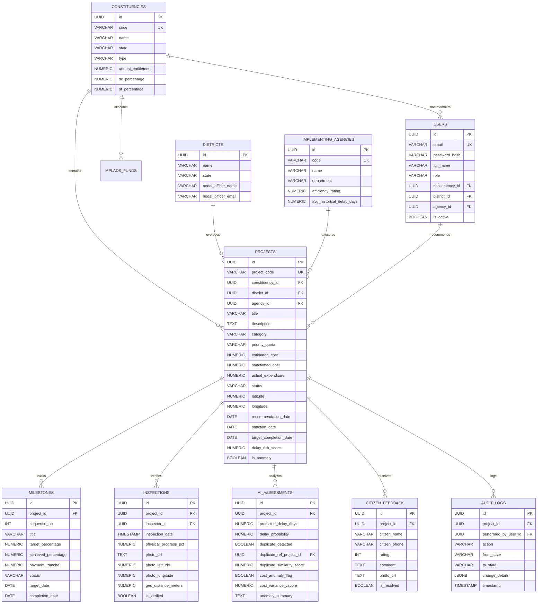

# MPLAD-AI: Shared Relational Data Schema (PostgreSQL)
**SIH 2026 Problem Statement ID: 26102**

---

## 1. Schema Design Principles
1. **Third Normal Form (3NF)**: Prevents data redundancy across constituencies, projects, milestones, and agencies.
2. **Referential Integrity**: Enforces strict foreign keys with explicit `ON DELETE RESTRICT` for core entities (preventing accidental deletion of active projects or funds).
3. **Auditability**: Every critical status change produces an immutable record in `audit_logs`.
4. **Spatial Optimization**: Stores precise coordinates (`latitude`, `longitude`) with indexing for radial radius queries (e.g., detecting duplicate works within 300 meters).
5. **JSONB Flexibility**: Uses `JSONB` for extensible metadata such as AI anomaly breakdown and audit state diffs without requiring schema migrations.

---

## 2. Entity-Relationship Overview



---

## 3. Production PostgreSQL DDL

```sql
-- PostgreSQL Version 15+
CREATE EXTENSION IF NOT EXISTS "uuid-ossp";

-- 1. Constituencies Table
CREATE TABLE constituencies (
    id UUID PRIMARY KEY DEFAULT uuid_generate_v4(),
    code VARCHAR(32) UNIQUE NOT NULL,
    name VARCHAR(128) NOT NULL,
    state VARCHAR(64) NOT NULL,
    type VARCHAR(32) NOT NULL CHECK (type IN ('LOK_SABHA', 'RAJYA_SABHA')),
    current_mp_name VARCHAR(128),
    current_mp_party VARCHAR(64),
    annual_entitlement NUMERIC(14, 2) DEFAULT 50000000.00, -- Rs 5.00 Crore
    sc_percentage NUMERIC(5, 2) DEFAULT 0.00,
    st_percentage NUMERIC(5, 2) DEFAULT 0.00,
    created_at TIMESTAMP WITH TIME ZONE DEFAULT CURRENT_TIMESTAMP,
    updated_at TIMESTAMP WITH TIME ZONE DEFAULT CURRENT_TIMESTAMP
);

-- 2. Districts Table
CREATE TABLE districts (
    id UUID PRIMARY KEY DEFAULT uuid_generate_v4(),
    name VARCHAR(128) NOT NULL,
    state VARCHAR(64) NOT NULL,
    nodal_officer_name VARCHAR(128),
    nodal_officer_email VARCHAR(128),
    nodal_officer_phone VARCHAR(32),
    created_at TIMESTAMP WITH TIME ZONE DEFAULT CURRENT_TIMESTAMP
);

-- 3. Implementing Agencies Table
CREATE TABLE implementing_agencies (
    id UUID PRIMARY KEY DEFAULT uuid_generate_v4(),
    code VARCHAR(32) UNIQUE NOT NULL,
    name VARCHAR(128) NOT NULL,
    department VARCHAR(64) NOT NULL, -- PWD, Rural Dev, Jal Nigam, Municipal Corp
    district_id UUID REFERENCES districts(id) ON DELETE SET NULL,
    efficiency_rating NUMERIC(3, 2) DEFAULT 3.00 CHECK (efficiency_rating BETWEEN 1.00 AND 5.00),
    avg_historical_delay_days NUMERIC(6, 1) DEFAULT 0.0,
    contact_phone VARCHAR(32),
    created_at TIMESTAMP WITH TIME ZONE DEFAULT CURRENT_TIMESTAMP
);

-- 4. Users Table (Role-Based Access)
CREATE TABLE users (
    id UUID PRIMARY KEY DEFAULT uuid_generate_v4(),
    email VARCHAR(128) UNIQUE NOT NULL,
    password_hash VARCHAR(256) NOT NULL,
    full_name VARCHAR(128) NOT NULL,
    role VARCHAR(32) NOT NULL CHECK (role IN (
        'MOSPI_ADMIN', 'MP', 'DISTRICT_COLLECTOR', 'IMPLEMENTING_AGENCY', 'CITIZEN'
    )),
    constituency_id UUID REFERENCES constituencies(id) ON DELETE SET NULL,
    district_id UUID REFERENCES districts(id) ON DELETE SET NULL,
    agency_id UUID REFERENCES implementing_agencies(id) ON DELETE SET NULL,
    is_active BOOLEAN DEFAULT TRUE,
    created_at TIMESTAMP WITH TIME ZONE DEFAULT CURRENT_TIMESTAMP
);

-- 5. Annual MPLADS Funds Accounting Table
CREATE TABLE mplads_funds (
    id UUID PRIMARY KEY DEFAULT uuid_generate_v4(),
    constituency_id UUID NOT NULL REFERENCES constituencies(id) ON DELETE RESTRICT,
    fiscal_year VARCHAR(16) NOT NULL, -- e.g., '2026-2027'
    total_entitlement NUMERIC(14, 2) DEFAULT 50000000.00,
    released_by_mospi NUMERIC(14, 2) DEFAULT 0.00,
    sanctioned_amount NUMERIC(14, 2) DEFAULT 0.00,
    expenditure_amount NUMERIC(14, 2) DEFAULT 0.00,
    unspent_balance NUMERIC(14, 2) GENERATED ALWAYS AS (released_by_mospi - expenditure_amount) STORED,
    sc_expenditure_amount NUMERIC(14, 2) DEFAULT 0.00,
    st_expenditure_amount NUMERIC(14, 2) DEFAULT 0.00,
    created_at TIMESTAMP WITH TIME ZONE DEFAULT CURRENT_TIMESTAMP,
    CONSTRAINT uq_constituency_fiscal UNIQUE (constituency_id, fiscal_year)
);

-- 6. Projects Table (Core Work Lifecycle)
CREATE TABLE projects (
    id UUID PRIMARY KEY DEFAULT uuid_generate_v4(),
    project_code VARCHAR(32) UNIQUE NOT NULL,
    constituency_id UUID NOT NULL REFERENCES constituencies(id) ON DELETE RESTRICT,
    district_id UUID NOT NULL REFERENCES districts(id) ON DELETE RESTRICT,
    agency_id UUID REFERENCES implementing_agencies(id) ON DELETE SET NULL,
    recommended_by_user_id UUID REFERENCES users(id) ON DELETE SET NULL,
    title VARCHAR(256) NOT NULL,
    description TEXT NOT NULL,
    category VARCHAR(64) NOT NULL CHECK (category IN (
        'DRINKING_WATER', 'EDUCATION', 'PUBLIC_HEALTH', 'SANITATION', 
        'ROADS_BRIDGES', 'IRRIGATION', 'COMMUNITY_INFRASTRUCTURE', 'OTHER'
    )),
    priority_quota VARCHAR(32) NOT NULL CHECK (priority_quota IN ('GENERAL', 'SC_MANDATE', 'ST_MANDATE')),
    estimated_cost NUMERIC(14, 2) NOT NULL CHECK (estimated_cost > 0),
    sanctioned_cost NUMERIC(14, 2) DEFAULT 0.00,
    actual_expenditure NUMERIC(14, 2) DEFAULT 0.00,
    status VARCHAR(32) NOT NULL DEFAULT 'PROPOSED' CHECK (status IN (
        'PROPOSED', 'SCRUTINIZED', 'SANCTIONED', 'WORK_ORDERED', 
        'IN_PROGRESS', 'COMPLETED', 'REJECTED', 'STALLED'
    )),
    latitude NUMERIC(10, 7) NOT NULL CHECK (latitude BETWEEN -90 AND 90),
    longitude NUMERIC(10, 7) NOT NULL CHECK (longitude BETWEEN -180 AND 180),
    location_address TEXT NOT NULL,
    recommendation_date DATE NOT NULL,
    sanction_date DATE,
    work_order_date DATE,
    target_completion_date DATE NOT NULL,
    actual_completion_date DATE,
    delay_risk_score NUMERIC(5, 2) DEFAULT 0.00 CHECK (delay_risk_score BETWEEN 0.00 AND 100.00),
    is_anomaly BOOLEAN DEFAULT FALSE,
    created_at TIMESTAMP WITH TIME ZONE DEFAULT CURRENT_TIMESTAMP,
    updated_at TIMESTAMP WITH TIME ZONE DEFAULT CURRENT_TIMESTAMP
);

-- 7. Project Milestones Table
CREATE TABLE milestones (
    id UUID PRIMARY KEY DEFAULT uuid_generate_v4(),
    project_id UUID NOT NULL REFERENCES projects(id) ON DELETE CASCADE,
    sequence_no INT NOT NULL,
    title VARCHAR(128) NOT NULL,
    target_percentage NUMERIC(5, 2) NOT NULL CHECK (target_percentage BETWEEN 0 AND 100),
    achieved_percentage NUMERIC(5, 2) DEFAULT 0.00 CHECK (achieved_percentage BETWEEN 0 AND 100),
    payment_tranche NUMERIC(14, 2) DEFAULT 0.00,
    status VARCHAR(32) DEFAULT 'PENDING' CHECK (status IN ('PENDING', 'IN_PROGRESS', 'COMPLETED', 'VERIFIED')),
    target_date DATE NOT NULL,
    completion_date DATE,
    created_at TIMESTAMP WITH TIME ZONE DEFAULT CURRENT_TIMESTAMP
);

-- 8. Geotagged Inspections Table
CREATE TABLE inspections (
    id UUID PRIMARY KEY DEFAULT uuid_generate_v4(),
    project_id UUID NOT NULL REFERENCES projects(id) ON DELETE CASCADE,
    inspector_id UUID REFERENCES users(id) ON DELETE SET NULL,
    inspection_date TIMESTAMP WITH TIME ZONE NOT NULL,
    physical_progress_pct NUMERIC(5, 2) NOT NULL CHECK (physical_progress_pct BETWEEN 0 AND 100),
    photo_url TEXT NOT NULL,
    photo_latitude NUMERIC(10, 7) NOT NULL,
    photo_longitude NUMERIC(10, 7) NOT NULL,
    geo_distance_meters NUMERIC(8, 2), -- Computed distance between photo GPS and registered work coordinate
    is_verified BOOLEAN DEFAULT FALSE,
    remarks TEXT,
    created_at TIMESTAMP WITH TIME ZONE DEFAULT CURRENT_TIMESTAMP
);

-- 9. AI Risk Assessments Table
CREATE TABLE ai_risk_assessments (
    id UUID PRIMARY KEY DEFAULT uuid_generate_v4(),
    project_id UUID NOT NULL REFERENCES projects(id) ON DELETE CASCADE,
    predicted_delay_days NUMERIC(6, 1) DEFAULT 0.0,
    delay_probability NUMERIC(4, 3) DEFAULT 0.000 CHECK (delay_probability BETWEEN 0.000 AND 1.000),
    duplicate_detected BOOLEAN DEFAULT FALSE,
    duplicate_ref_project_id UUID REFERENCES projects(id) ON DELETE SET NULL,
    duplicate_similarity_score NUMERIC(4, 3) DEFAULT 0.000,
    cost_anomaly_flag BOOLEAN DEFAULT FALSE,
    cost_variance_zscore NUMERIC(6, 2) DEFAULT 0.00,
    anomaly_summary TEXT,
    generated_at TIMESTAMP WITH TIME ZONE DEFAULT CURRENT_TIMESTAMP
);

-- 10. Citizen Feedback & Grievance Table
CREATE TABLE citizen_feedback (
    id UUID PRIMARY KEY DEFAULT uuid_generate_v4(),
    project_id UUID NOT NULL REFERENCES projects(id) ON DELETE CASCADE,
    citizen_name VARCHAR(128),
    citizen_phone VARCHAR(32),
    rating INT CHECK (rating BETWEEN 1 AND 5),
    comment TEXT NOT NULL,
    photo_url TEXT,
    is_resolved BOOLEAN DEFAULT FALSE,
    resolution_remarks TEXT,
    created_at TIMESTAMP WITH TIME ZONE DEFAULT CURRENT_TIMESTAMP
);

-- 11. Audit Logs (Immutable Event Ledger)
CREATE TABLE audit_logs (
    id UUID PRIMARY KEY DEFAULT uuid_generate_v4(),
    project_id UUID NOT NULL REFERENCES projects(id) ON DELETE CASCADE,
    performed_by_user_id UUID REFERENCES users(id) ON DELETE SET NULL,
    action VARCHAR(64) NOT NULL, -- STATUS_TRANSITION, COST_AMENDMENT, DISBURSEMENT_TRIGGER
    from_state VARCHAR(64),
    to_state VARCHAR(64),
    change_details JSONB,
    timestamp TIMESTAMP WITH TIME ZONE DEFAULT CURRENT_TIMESTAMP
);

-- Indices for Query Performance
CREATE INDEX idx_projects_constituency ON projects(constituency_id);
CREATE INDEX idx_projects_district ON projects(district_id);
CREATE INDEX idx_projects_status ON projects(status);
CREATE INDEX idx_projects_category ON projects(category);
CREATE INDEX idx_projects_priority_quota ON projects(priority_quota);
CREATE INDEX idx_projects_coordinates ON projects(latitude, longitude);
CREATE INDEX idx_milestones_project ON milestones(project_id);
CREATE INDEX idx_inspections_project ON inspections(project_id);
CREATE INDEX idx_ai_assessments_project ON ai_risk_assessments(project_id);
CREATE INDEX idx_audit_logs_project ON audit_logs(project_id);
```
