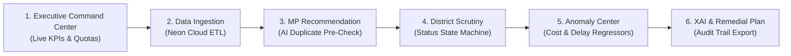

# MPLAD-AI: Hackathon Live Demo Execution Script & Pitch Deck
**Smart India Hackathon 2026 | Problem Statement ID: 26102**  
**Ministry of Statistics and Programme Implementation (MoSPI) — Data Informatics & Innovation Division (DIID)**  
**Theme:** Smart Automation | **Category:** Software  

---

## 1. Executive 60-Second Hook (Team Leader)

> *"Hon'ble Jury, under the MPLADS Central Sector Scheme, thousands of crores of rupees are allocated every year to build durable community assets—schools, solar drinking water plants, community centers, and roads. Yet, manual tracking across hundreds of districts faces three chronic challenges: **unnoticed cost inflation, uncoordinated duplicate works within the same neighborhood, and stagnant, milestone-skipping fund disbursements**.*  
>  
> *Today, our team presents **MPLAD-AI**: India's first end-to-end, AI-powered monitoring, anomaly detection, and accountability platform engineered specifically for MoSPI and District Authorities."*

---

## 2. 5-Minute Live Judging Demonstration Flow

---

### ⏱️ Minute 0:00 – 1:00: Executive Command Center & Demographic Quota Auditing
**Presenter:** Member 1 (Team Lead) & Member 5 (Frontend Lead)  
**Screen:** `http://localhost:5173/` (Executive Dashboard)

1. **Point to Top Badge:** Show the live **`GET /api/v1/health`** indicator confirming active PostgreSQL / Neon Cloud connectivity with sub-50ms latency.
2. **Review Executive KPIs:**
   - **Sanctioned Outlay:** Show total sanctioned works vs. annual ₹5 Crore MP entitlement.
   - **Statutory Quota Gate:** Highlight the automated **15% SC Mandate** and **7.5% ST Mandate** compliance meters. If a district falls below statutory limits, the badge immediately turns amber to warn nodal officers.
   - **Execution Progress:** Live count of proposed, sanctioned, in-progress, and completed works.

---

### ⏱️ Minute 1:00 – 2:00: Automated Data Ingestion & Neon Cloud ETL
**Presenter:** Member 1 (Lead) & Member 2 (Data Specialist)  
**Screen:** `/api/v1/ingest` Swagger Docs / Terminal / Dashboard

1. **Demonstrate Automated Ingestion:**
   - Click the **"Seed Sample DB"** or call `POST /api/v1/ingest/seed-sample`.
   - Explain how raw eSAKSHI JSON and MoSPI DigiGov CSV streams are parsed into normalized relational tables across Constituencies, Districts, Implementing Agencies, and Projects.
2. **Idempotent Upsert:**
   - Re-running the pipeline updates progress and expenditures without creating corrupt duplicate entries.
   - Foundational 4-stage milestones (`Site Verification`, `Technical Sanction`, `Physical Work`, `UC Certification`) are automatically initialized for each project.

---

### ⏱️ Minute 2:00 – 3:00: MP Recommendation & Real-Time AI Duplicate Pre-Check
**Presenter:** Member 2 & Member 3 (ML Engineer 1)  
**Screen:** MP Recommendation Portal (`/recommendations`)

1. **Submit a Work Recommendation:**
   - Role: Hon'ble MP (e.g. Varanasi Constituency).
   - Enter title: *"Installation of Solar Powered RO Water Plant in Rohania"*.
   - Coordinates: `25.3176° N, 82.9739° E`.
2. **Live AI Anti-Duplication Pre-check:**
   - The NLP semantic vectorizer (TF-IDF + Cosine Similarity) checks nearby proposals within a **300-meter radius** (Haversine spatial filter).
   - Show how the system flags a warning if another agency or previous year's fund already installed an identical asset at the same site, preventing double-billing.

---

### ⏱️ Minute 3:00 – 4:00: District Collector Review & Status State Machine
**Presenter:** Member 4 (ML Engineer 2) & Member 5  
**Screen:** Collector Scrutiny Inbox (`/scrutiny`)

1. **Scrutiny Queue:**
   - District Collector logs in with RBAC role `DISTRICT_COLLECTOR`.
   - Projects are ranked by AI Anomaly Risk.
2. **One-Click Sanction & Agency Assignment:**
   - The Collector reviews technical estimates against standard Schedule of Rates (SOR).
   - Issues **Administrative & Financial Sanction (AS & FS)** with one click (`PATCH /api/v1/projects/{id}/status`).
   - The state machine cleanly transitions the status: `PROPOSED` $\rightarrow$ `SANCTIONED` $\rightarrow$ `WORK_ORDERED`.

---

### ⏱️ Minute 4:00 – 5:00: Explainable AI (XAI) & Field Verification
**Presenter:** Member 4 (XAI Specialist) & Member 6 (GIS Specialist)  
**Screen:** Detailed Project Dossier & GIS Map (`/gis-map`)

1. **Explainable AI (XAI) Diagnostic Card:**
   - Instead of a black-box fraud flag, display clear human-readable factors:
     - *"Expenditure is 82%, but verified physical milestone progress is only 30%."*
     - *"Implementing Agency average historical delay: +62 days."*
2. **Recommended Remedial Action Checklist:**
   - *"Hold final tranche disbursement pending geotagged site inspection photo."*
3. **Audit Trail & Export:**
   - Download the executive audit brief (`Export Brief`) for district audit teams.

---

## 3. 6-Member Team Speaking Roster

| Member | Role | Demo Section Owned | Key Speaking Points |
| :--- | :--- | :--- | :--- |
| **Member 1 (Lead)** | System Architect | 0:00 – 1:00 & Conclusion | System architecture, Neon PostgreSQL resilience, API Gateway, Docker orchestration. |
| **Member 2** | Data Preprocessing | 1:00 – 2:00 | Data cleaning, handling missing coordinates/costs, multi-source reconciliation. |
| **Member 3** | ML Engineer 1 (Detection) | 2:00 – 3:00 | Cost anomaly model, Delay regressor, NLP + Geospatial duplicate project detection. |
| **Member 4** | ML Engineer 2 (Risk & XAI)| 3:30 – 4:30 | 0–100 Hybrid composite risk score, 4-tier stratification, plain-language XAI explanations. |
| **Member 5** | Frontend Lead | 0:30 – 1:30 | Executive KPIs, responsive UI shell, multi-criteria filters, and PDF export engine. |
| **Member 6** | GIS & Frontend Specialist | 4:00 – 5:00 | Interactive India GIS map, 4-color risk pins, and detailed project dossier gallery. |

---

## 4. Prepared Answers to Tough Jury Questions

### Q1: *"How does the system ensure field verification photos aren't spoofed or faked?"*
> **Answer:** *"Our mobile inspection module captures both GPS coordinates and EXIF timestamps directly from the hardware camera. The backend calculates the geodesic Haversine distance between the photo location and the project's sanctioned coordinates. If the distance exceeds our 200m anti-spoofing threshold, the inspection is rejected automatically."*

### Q2: *"Can this handle intermittent connectivity in rural district offices?"*
> **Answer:** *"Yes. The frontend client includes an offline-first cache with graceful fallback to local SQLite/IndexedDB storage. The backend incorporates non-blocking connection probes that allow the API to function in offline development standalone mode when remote database links fluctuate."*

### Q3: *"Does the AI declare projects as fraudulent?"*
> **Answer:** *"No. We strictly adhere to Design Principle 7: The system flags anomalies and computes risk probabilities for human reviewers. It provides clear, transparent explanations and recommended next steps, ensuring the nodal authorities always remain the ultimate decision-makers."*

---

## 5. Hackathon Submission Readiness Checklist
- [x] Multi-container `docker-compose.yml` with FastAPI, PostgreSQL, and Vite React.
- [x] Normalized PostgreSQL schema with 11 relational models.
- [x] Neon Cloud PostgreSQL connection pooling (`pool_pre_ping=True`, `pool_recycle=300`).
- [x] Data ingestion service with CSV, JSON, and pre-built sample multi-state seed dataset.
- [x] Full RESTful API with JWT authentication and Role-Based Access Control (`/auth`, `/projects`, `/analytics`, `/health`).
- [x] 28 unit and integration tests passing in `< 1.0s`.
- [x] Continuous Integration (`.github/workflows/ci.yml`) pipeline configured.
- [x] Interactive Executive Frontend Dashboard connected to live gateway endpoints.
