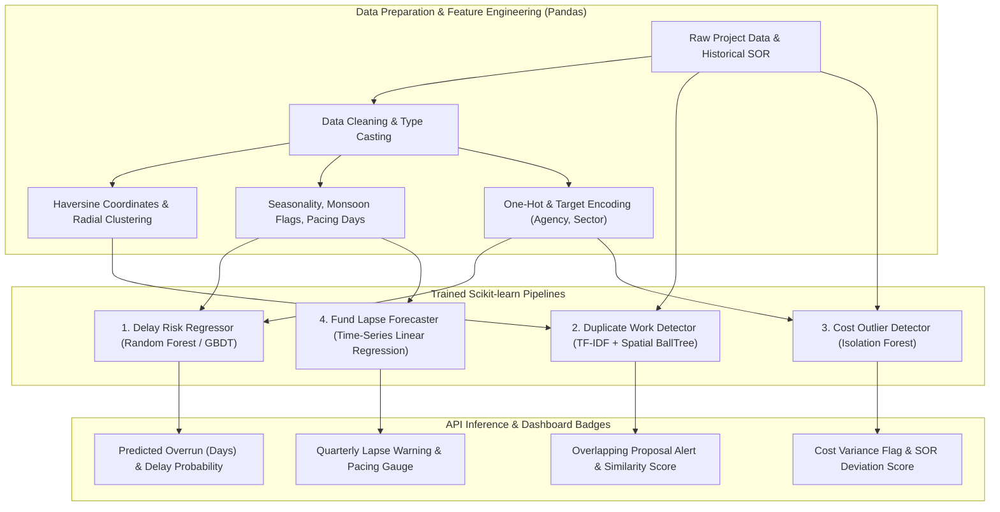

# MPLAD-AI: Machine Learning & Predictive Analytics Specification
**Pandas & Scikit-learn Pipeline Design | SIH 2026 Problem Statement ID: 26102**

---

## 1. Overview of AI/ML Modules

MPLAD-AI integrates four machine learning and analytical pipelines to solve core accountability bottlenecks in the MPLADS scheme:



---

## 2. Pipeline 1: Project Delay Prediction Regressor

### 2.1 Problem Formulation
Predict the number of delay days beyond the target completion date:
$$\text{Delay Days} = \text{Actual Completion Date} - \text{Target Completion Date}$$

### 2.2 Feature Engineering (Pandas)
- `category_encoded`: One-hot encoded project sector (Drinking Water, Sanitation, Roads, etc.).
- `estimated_cost_log`: Log-transformed estimated cost $\log_{10}(\text{cost})$.
- `target_duration_days`: Number of planned execution days ($\text{target\_date} - \text{sanction\_date}$).
- `agency_historical_delay_avg`: Rolling average delay of the assigned implementing agency over the past 3 years.
- `monsoon_overlap_months`: Number of project execution months overlapping with the local monsoon season (June to September).
- `priority_quota`: Binary flag for SC/ST statutory quota projects.
- `sanction_latency_days`: Latency between MP recommendation and administrative sanction.

### 2.3 Model Architecture & Training (Scikit-learn)
- **Algorithm**: `HistGradientBoostingRegressor` / `RandomForestRegressor`.
- **Loss Function**: Mean Squared Error (MSE) / Huber Loss (robust to extreme delay outliers).
- **Hyperparameter Grid**:
  - `n_estimators`: `[100, 200, 300]`
  - `max_depth`: `[6, 10, 15]`
  - `min_samples_split`: `[5, 10]`
- **Evaluation Metrics**:
  - Mean Absolute Error (MAE): Target $\le 18 \text{ days}$.
  - Root Mean Squared Error (RMSE).
  - $R^2$ Score.
- **Serialization**: Saved using `joblib.dump(pipeline, 'saved_models/delay_model_v1.joblib')`.

---

## 3. Pipeline 2: Duplicate Work & Spatial Overlap Detector

### 3.1 Problem Formulation
Prevent duplicate fund allocation where a proposed project matches an existing or recently sanctioned work in both textual description and physical location.

### 3.2 Dual-Stage Detection Pipeline
1. **Spatial Proximity Filter (Haversine Distance)**:
   - Calculate geodesic distance between the candidate project $(\phi_1, \lambda_1)$ and all historical projects in the same district $(\phi_2, \lambda_2)$:
   $$d = 2R \arcsin \left(\sqrt{\sin^2\left(\frac{\Delta\phi}{2}\right) + \cos\phi_1 \cos\phi_2 \sin^2\left(\frac{\Delta\lambda}{2}\right)}\right)$$
   - Retain only candidates within a radius threshold $d \le 300 \text{ meters}$.
2. **Text Semantic Similarity (Scikit-learn TF-IDF + Cosine Similarity)**:
   - Apply `TfidfVectorizer(ngram_range=(1, 3), stop_words='english')` on `title` + `description`.
   - Compute cosine similarity matrix between candidate text vector $u$ and nearby project vectors $v$:
   $$\text{Similarity}(u, v) = \frac{u \cdot v}{\|u\| \|v\|}$$
3. **Threshold Logic**:
   - If $\text{Distance} \le 300\text{m}$ AND $\text{Similarity} \ge 0.70 \implies \text{CRITICAL\_DUPLICATE\_WARNING}$.
   - If $\text{Distance} \le 500\text{m}$ AND $\text{Similarity} \ge 0.50 \implies \text{MODERATE\_OVERLAP\_ALERT}$.

---

## 4. Pipeline 3: Cost Outlier & Schedule of Rates (SOR) Validator

### 4.1 Problem Formulation
Detect anomalous budget estimates deviating significantly from benchmark rates for comparable asset specifications (e.g. cost per meter of cement concrete road or cost per solar street light unit).

### 4.2 Algorithm & Logic (Scikit-learn Isolation Forest)
- **Feature Vector**:
  - `cost_per_unit`: Normalized cost calculated from description metrics.
  - `cost_to_duration_ratio`: $\frac{\text{Estimated Cost}}{\text{Planned Duration}}$.
  - `district_cost_factor`: Relative labor and material index of the district.
- **Model**: `IsolationForest(contamination=0.05, random_state=42)`.
- **Outlier Flag**: Projects receiving an anomaly score $s < -0.2$ are flagged with `is_anomaly = True` and surfaced on the District Collector scrutiny inbox with the specific deviation magnitude.

---

## 5. Pipeline 4: Fund Lapse Risk & Expenditure Pacing Forecaster

### 5.1 Problem Formulation
Predict whether a constituency's unspent entitlement will exceed the permissible rollover threshold by March 31st of the current fiscal year.

### 5.2 Pacing Formula & Linear Trend
$$\text{Expected Pacing} = \frac{\text{Days Elapsed in Fiscal Year}}{365} \times \text{Annual Entitlement}$$
$$\text{Pacing Deficit} = \text{Expected Pacing} - \text{Cumulative Actual Expenditure}$$
- If $\text{Pacing Deficit} > ₹ 1.50 \text{ Crore}$ with less than 90 days remaining, generate automated escalation alert to the District Authority and MP recommending accelerated sanction of pipeline works.

---

## 6. Directory Layout for ML Lab

```
ml_engine/
├── data/
│   ├── raw/                      # Baseline synthetic MPLADS historical records
│   └── processed/                # Normalized feature matrices (.parquet / .csv)
├── notebooks/
│   ├── 01_eda_and_data_generation.ipynb
│   ├── 02_delay_prediction_experiments.ipynb
│   └── 03_duplicate_detection_experiments.ipynb
├── pipelines/
│   ├── train_delay_model.py      # Standalone training script for delay regressor
│   ├── train_duplicate_index.py  # Builds spatial BallTree and TF-IDF index
│   └── train_cost_anomaly.py     # Fits Isolation Forest on historical costs
├── saved_models/
│   ├── delay_model_v1.joblib
│   ├── tfidf_vectorizer_v1.joblib
│   └── cost_anomaly_v1.joblib
└── requirements.txt              # pandas, scikit-learn, numpy, scipy, joblib
```
