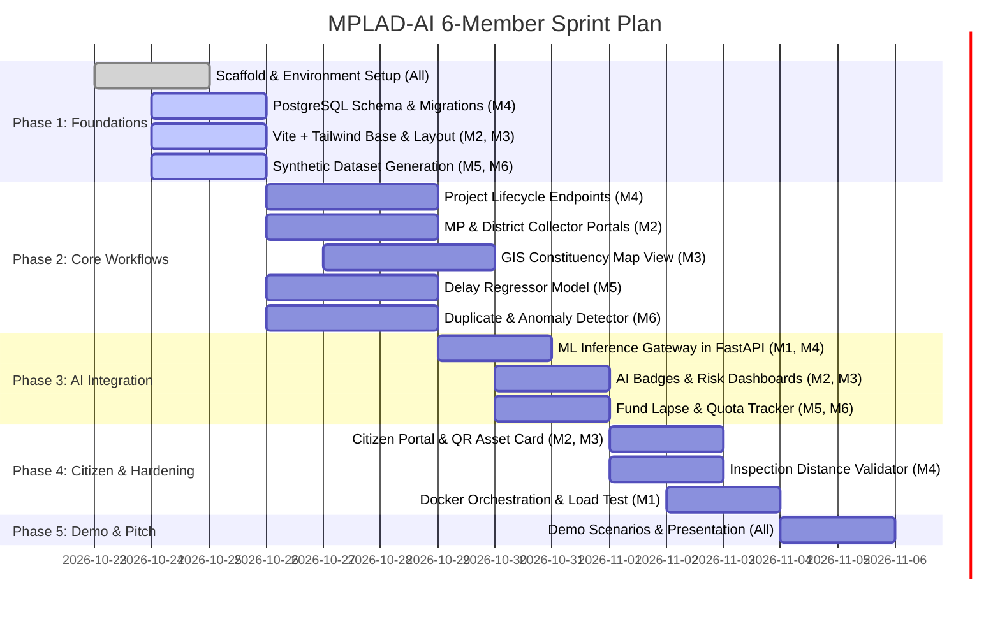

# MPLAD-AI: Phased Implementation Roadmap
**SIH 2026 Problem Statement ID: 26102 | 6-Member Engineering Team**

---

## 1. Team Allocation Matrix

| Member | Primary Role | Domain & Core Technologies | Primary Deliverables |
| :--- | :--- | :--- | :--- |
| **Member 1 (Lead)** | System Architect & Full-Stack Lead | Architecture, FastAPI orchestration, Docker, RBAC | Core API Gateway, Auth Middleware, Docker Compose, Demo Script |
| **Member 2** | Frontend Lead | React 18, Vite, Tailwind CSS, TanStack Query | Design System, MP Recommendation Portal, District Scrutiny Portal |
| **Member 3** | Frontend & GIS Specialist | Leaflet, Recharts, Responsive UI | Interactive Map, Citizen Transparency Portal, QR Code Generator |
| **Member 4** | Backend & Database Specialist | PostgreSQL, SQLAlchemy, Alembic, PostGIS | Database DDL, Migrations, CRUD Services, Audit Logger |
| **Member 5** | ML Engineer 1 (Predictive Analytics)| Pandas, Scikit-learn (Regression, Time-Series) | Delay Prediction Regressor, Fund Lapse Forecaster, Feature Pipeline |
| **Member 6** | ML Engineer 2 (Anomaly & Duplicate) | Scikit-learn (TF-IDF, Isolation Forest, Spatial) | Duplicate Proposal Detector, Cost Outlier Engine, Sector NLP Tagger |

---

## 2. Sprint Roadmap (Hackathon Timeline)

---

## 3. Phase-by-Phase Task Breakdown & Acceptance Criteria

### Phase 1: Architecture, Setup & Foundational Schema (Days 1–2)
- **Objective**: Establish consistent, unblocked development environments across frontend, backend, and machine learning pipelines.
- **Member 1 (Lead)**:
  - Configure root directory structure, Git branching guidelines, and environment configurations (`.env.example`).
  - Set up FastAPI project skeleton with CORS middleware, dependency injection structure, and health check endpoints.
- **Member 2 (Frontend Lead)**:
  - Initialize Vite + React project with Tailwind CSS, Lucide icons, and theme configuration.
  - Implement reusable UI shell: Navbar, Sidebar, Breadcrumbs, and Responsive Container.
- **Member 3 (Frontend & GIS)**:
  - Install and configure Leaflet / React-Leaflet with OpenStreetMap / Carto basemap tiles.
  - Create mock data fixtures for constituency coordinates and marker clustering.
- **Member 4 (Backend & DB)**:
  - Set up PostgreSQL database with SQLAlchemy 2.0 ORM models and Alembic migration scripts.
  - Create database seed script with sample Indian states, constituencies (Varanasi, Wayanad, New Delhi), and implementing agencies.
- **Members 5 & 6 (ML Engineers)**:
  - Generate a synthetic dataset of 2,000+ realistic MPLADS projects containing: project titles, categories, costs, implementing agencies, timelines, actual completion dates, and geo-coordinates.
  - Clean and structure data into train/test splits.
- **Milestone 1 Acceptance**:
  - `docker compose up` starts PostgreSQL and FastAPI with working `/health` endpoint.
  - Frontend renders dashboard shell at `http://localhost:5173`.
  - Initial database migration applies cleanly.

---

### Phase 2: Core Workflows & Ingestion Engine (Days 3–5)
- **Objective**: Complete end-to-end operational flow from work proposal to agency sanction.
- **Member 1 (Lead)**:
  - Implement JWT authentication and role-based dependency checks (`get_current_active_user`, `require_role(["MP", "DISTRICT_COLLECTOR"])`).
- **Member 4 (Backend & DB)**:
  - Implement CRUD endpoints for `/api/v1/projects`: creation, filtering, pagination, and detail views.
  - Implement project status transition state machine with validation (`PROPOSED` -> `SCRUTINIZED` -> `SANCTIONED`).
  - Implement `/api/v1/milestones` and payment tranche endpoints.
- **Member 2 (Frontend Lead)**:
  - Build MP Proposal Submission Form with category selector, SC/ST priority toggle, and cost estimator.
  - Build District Collector Review Inbox: List of pending proposals with action buttons (Approve, Reject, Request Clarification).
- **Member 3 (Frontend & GIS)**:
  - Render interactive GIS map displaying project locations color-coded by lifecycle status.
  - Implement slide-out Project Dossier Drawer when clicking a map marker.
- **Member 5 (ML Engineer 1)**:
  - Train Delay Risk Regressor (Random Forest / GBDT) using historical features.
  - Evaluate model: Target MAE < 20 days on synthetic validation set.
- **Member 6 (ML Engineer 2)**:
  - Build Text TF-IDF + Cosine Similarity engine for work titles and descriptions.
  - Combine with spatial Haversine distance threshold to detect proposals within 300m radius.
- **Milestone 2 Acceptance**:
  - MP user can submit a project recommendation.
  - District Collector can view the submitted project and change status to `SANCTIONED`.
  - GIS map displays the newly created project at its assigned latitude/longitude.

---

### Phase 3: AI Engine Integration & Risk Analytics (Days 6–7)
- **Objective**: Connect trained machine learning models into real-time API transactions.
- **Member 1 & Member 4**:
  - Integrate ML inference helpers into FastAPI: On `POST /api/v1/projects`, automatically run duplicate and cost anomaly checks.
  - Save predictions into `ai_risk_assessments` table.
- **Member 5 (ML Engineer 1)**:
  - Implement Fund Lapse Risk Model: Calculates expected expenditure trajectory against fiscal year deadline.
  - Expose `/api/v1/ai/fund-forecast` endpoint.
- **Member 6 (ML Engineer 2)**:
  - Train Isolation Forest model for cost outlier detection against benchmark Schedule of Rates (SOR).
  - Expose `/api/v1/ai/check-duplicates` and `/api/v1/ai/cost-anomaly` endpoints.
- **Member 2 (Frontend Lead)**:
  - Display AI Risk Badges (Low, Medium, High Delay Risk) on the Collector Dashboard.
  - Add Duplicate Work Alert Banner showing overlapping project ID and distance.
- **Member 3 (Frontend & GIS)**:
  - Build SC/ST Quota Compliance Gauge (verifying 15% SC / 7.5% ST target progress).
  - Add Recharts budget analytics: Sanctioned vs Disbursed vs Utilized.
- **Milestone 3 Acceptance**:
  - Submitting a duplicate proposal immediately triggers a red warning banner with matched existing asset details.
  - A proposed work with inflated budget gets flagged with a Cost Outlier score.

---

### Phase 4: Citizen Transparency, Mobile Verification & Hardening (Days 8–9)
- **Objective**: Build public trust interfaces, anti-spoofing field verification, and performance hardening.
- **Member 3 (Frontend & GIS)**:
  - Build Citizen Public Portal: Fast search by PIN code or Constituency name without requiring login.
  - Implement Citizen Grievance & Feedback form with rating stars and photo upload.
- **Member 2 (Frontend Lead)**:
  - Build Printable/Digital QR Code Asset Card for on-site physical display.
  - Mobile-responsive layout optimizations for field access.
- **Member 4 (Backend & DB)**:
  - Build Inspection Photo Upload endpoint with GPS EXIF verification and distance calculation:
    - If distance between photo coordinates and registered project coordinates > 200m, mark `is_verified = FALSE` and log warning.
- **Member 1 (Lead)**:
  - Finalize multi-container `docker-compose.yml` (`frontend`, `backend`, `postgres`).
  - Perform backend load testing with 5,000 synthetic projects.
- **Milestone 4 Acceptance**:
  - Public users can view verified project progress and photos.
  - Geotag photos taken outside permitted threshold are flagged automatically.
  - One-command startup works cleanly via Docker Compose.

---

### Phase 5: Demo Rehearsal, Edge Case Curation & Pitch (Days 10+)
- **Objective**: Polish presentation, live demonstration flow, and judges' evaluation criteria.
- **All Team Members**:
  - **Scenario 1 (Duplicate Prevention)**: MP recommends a solar street light project at coordinates where an existing project already completed last year; AI flags duplicate within 150m with 88% similarity score.
  - **Scenario 2 (Delay Mitigation)**: District Collector views a high-value road project flagged with 75-day predicted delay due to agency backlog; reassigns work to top-rated agency.
  - **Scenario 3 (Constituency Equity)**: MoSPI dashboard shows a constituency falling short on its mandatory 15% SC allocation, triggering automated allocation recommendations.
  - Prepare slide deck, architecture diagrams, and 3-minute video walkthrough.
