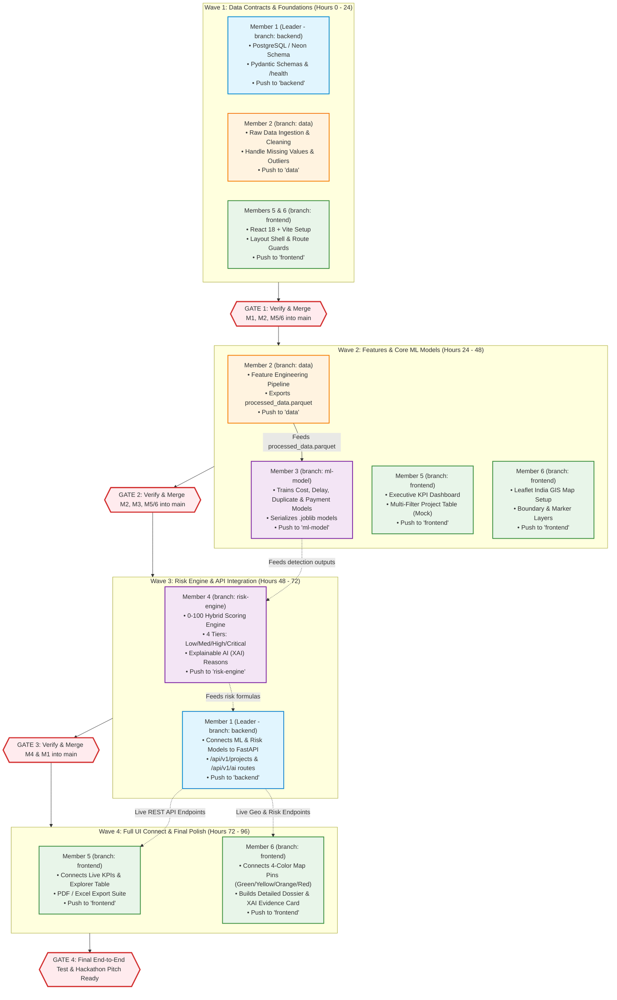

# MPLAD-AI: Execution Order & Branch Synchronization Timeline
**Preventing Team Mismatches, Merge Conflicts & Broken Dependencies**  
**Smart India Hackathon 2026 | Problem Statement ID: 26102**

---

## 1. Master Chronological Execution Flowchart

To prevent data mismatches and broken APIs, team members must execute and push their tasks in **4 Sequential Waves**. Nobody should jump to a dependent task before the foundation is verified and merged into `main`.



---

## 2. Who Waits for Whom? (Strict Dependency Rules)

To prevent breaking code:

1. **Member 3 (ML Models) MUST WAIT for Member 2 (Feature Engineering):**  
   - Member 3 cannot train cost or delay models until Member 2 produces `processed_dataset.parquet` with normalized cost ratios and delay elapsed flags.
2. **Member 4 (Risk Engine) MUST WAIT for Member 3 (Detection Models):**  
   - Member 4 cannot compute the 0–100 composite risk score until Member 3 provides the individual model outputs (cost anomaly score, delay days, duplicate similarity, payment flags).
3. **Member 1 (Backend API) MUST WAIT for Member 4 (Risk Engine):**  
   - Member 1 cannot expose `/api/v1/ai/risk-assessment` until Member 4 finalizes the Risk Engine class and XAI reason generator.
4. **Members 5 & 6 (Frontend) CAN BUILD UI IN PARALLEL with Mock Data:**  
   - Frontend developers can design components, tables, and maps using mock JSON during Waves 1–2.  
   - They **switch to live APIs** in Wave 4 only after Member 1 merges live backend routes into `main`.

---

## 3. Step-by-Step Push & Pull Instructions for Teammates

### Rule: Always Pull Latest `main` Before Pushing!
Whenever a Gate is merged, all teammates must run:
```bash
# Update local branch with the latest verified main
git checkout <your-branch>
git pull origin main
```

### When Finishing a Task:
```bash
# Example for Member 3 on ml-model
git checkout ml-model
git add ml_engine/detection/
git commit -m "feat(ml): implement delay regressor and duplicate detection"
git push origin ml-model
```

Then tell the Team Leader:
> *"I have pushed my subtask to `ml-model`. Ready for verification."*
