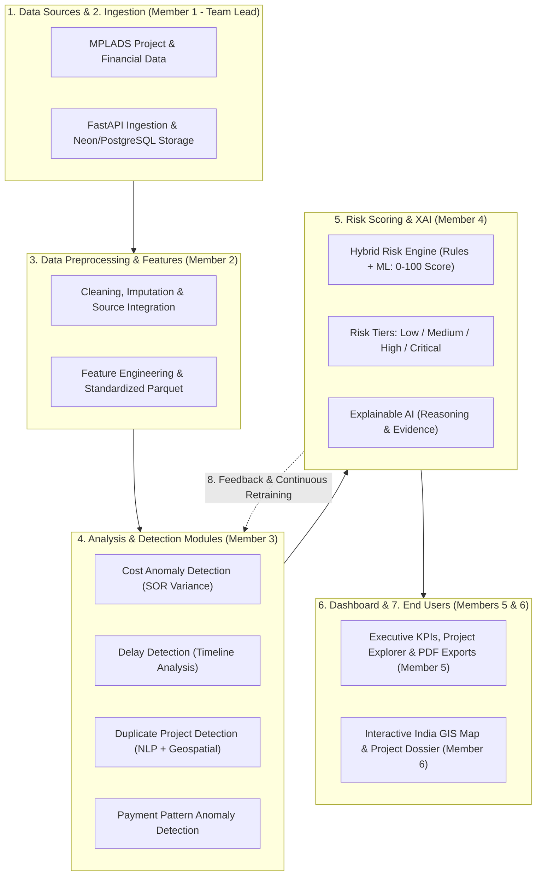
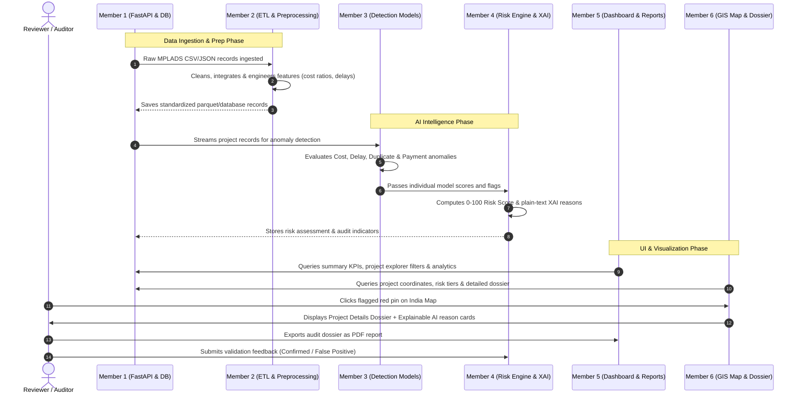

# MPLAD-AI: 6-Member Team Task Allocation & Execution Blueprint
**Smart India Hackathon 2026 | Problem Statement ID: 26102**  
**Ministry of Statistics and Programme Implementation (MoSPI) — Data Informatics & Innovation Division (DIID)**  
**Theme:** Smart Automation | **Category:** Software  

---

## 1. Executive Context & System Architecture Flowchart

This task allocation is strictly designed according to the official **MPLAD-AI Architecture Flowchart**, dividing the 8 core operational blocks across a **6-member engineering team**:

---

## 2. 6-Member Responsibility Matrix Overview

| Member | Title / Role | Primary Flowchart Domain | Primary Tech Stack |
| :--- | :--- | :--- | :--- |
| **Member 1 (Leader)** | System Architect & Backend Lead | 1. Data Sources, 2. Ingestion & Storage, API Gateway | FastAPI, PostgreSQL/Neon, Docker, Alembic, JWT |
| **Member 2** | Data Engineer & Preprocessing Specialist | 3. Data Preprocessing & Feature Engineering | Pandas, NumPy, Scikit-learn, GeoPandas |
| **Member 3** | ML Engineer 1 (Detection Specialist) | 4. Analysis & Detection Modules (Cost, Delay, Duplicate, Payment) | Scikit-learn, XGBoost, TF-IDF, Haversine, Joblib |
| **Member 4** | ML Engineer 2 (Risk & Explainable AI) | 5. Risk Scoring & 8. Continuous Feedback Loop | Python, SHAP / Feature Attribution, Rule Engine |
| **Member 5** | Frontend Lead (Dashboards & Reports) | 6. Web Application (KPIs, Explorer, Analytics, Exports) | React 18, Vite, Tailwind CSS, Recharts, jsPDF |
| **Member 6** | Frontend & GIS Specialist (Maps & Dossier) | 6. India GIS Map, Detailed Project Dossier & XAI Views | Leaflet / MapLibre, React-Leaflet, Tailwind CSS |

---

## 3. Detailed Member Tasks (5 Subtasks Per Member)

---

### 🧑‍💼 Member 1: Team Leader — System Architecture, Ingestion & Database
**Primary Focus:** Project coordination, database persistence, automated data ingestion pipelines, and secure API gateway.

- [ ] **Subtask 1.1: Core Monorepo Setup & Docker Orchestration**
  - Maintain root repository structure, environment configurations (`.env.example`), and multi-container `docker-compose.yml` uniting FastAPI, PostgreSQL, and Vite React.
  - Establish Git branching conventions (`main`, `develop`, `feature/*`) and enforce PR merge gates.
- [ ] **Subtask 1.2: Relational Database Modeling & Migrations**
  - Implement and maintain normalized PostgreSQL schemas (Constituencies, Projects, Sanctions, Payments, Milestones, Implementing Agencies) using SQLAlchemy 2.0.
  - Configure Alembic database migration scripts and verify Neon Cloud PostgreSQL connection pooling.
- [ ] **Subtask 1.3: Data Ingestion & Automated ETL Pipeline**
  - Develop ingestion scripts parsing official MPLADS datasets (CSV, Excel, eSAKSHI JSON, MoSPI DigiGov portal data).
  - Build scheduled batch update jobs to simulate periodic ingestion of new works and financial releases.
- [ ] **Subtask 1.4: FastAPI REST Gateway & RBAC Security**
  - Build core REST API routers (`/api/v1/auth`, `/api/v1/projects`, `/api/v1/analytics`, `/api/v1/health`).
  - Implement JWT authentication and Role-Based Access Control (RBAC) supporting: MoSPI Admin, District/Nodal Authority, MP, and Auditor roles.
- [ ] **Subtask 1.5: End-to-End System Integration & Hackathon Delivery**
  - Coordinate interface contracts between Frontend, Backend, and ML inference wrappers.
  - Run continuous integration tests, prepare the final demo execution script, and lead the technical pitch presentation.

---

### 🧑‍💻 Member 2: Data Preprocessing & Feature Engineering Specialist
**Primary Focus:** Turning messy raw public data into clean, structured, and feature-rich datasets ready for anomaly detection.

- [ ] **Subtask 2.1: Automated Data Cleaning & Imputation Pipeline**
  - Implement Pandas scripts to detect and handle missing timestamps, corrupted sanction numbers, null coordinates, and invalid budget inputs.
  - Standardize currency units (INR Crore / Lakhs) and normalize date formats across historical project files.
- [ ] **Subtask 2.2: Multi-Source Data Merging & Reconciliation**
  - Join project recommendations, administrative sanctions, milestone progress percentages, contractor logs, and payment disbursements using unique project IDs.
  - Reconcile discrepancies between sanctioned amounts and cumulative tranche releases.
- [ ] **Subtask 2.3: Domain-Specific Feature Engineering**
  - Calculate key analytical features:
    - `expenditure_to_progress_ratio`: $\frac{\text{Cumulative Expenditure}}{\text{Physical Progress \%}}$
    - `time_elapsed_ratio`: $\frac{\text{Current Date} - \text{Sanction Date}}{\text{Target Date} - \text{Sanction Date}}$
    - `expenditure_velocity`: Average monthly spend rate.
    - `contractor_concentration_index`: Proportion of district works assigned to a single agency.
- [ ] **Subtask 2.4: Geospatial, Demographic & Seasonal Normalization**
  - Validate and bound coordinates (latitude/longitude) against district and constituency shapefiles.
  - Encode priority quota indicators (15% Scheduled Caste / 7.5% Scheduled Tribe mandates) and monsoon weather seasonality flags.
- [ ] **Subtask 2.5: Benchmark Dataset Generation & Edge Case Generator**
  - Export standardized output matrices (`processed_mplads_data.parquet` and `.csv`) for training ML models.
  - Create synthetic test datasets containing known edge cases (e.g. duplicate works, cost inflation, stagnant progress) for system testing.

---

### 🤖 Member 3: ML Engineer 1 — Detection Modules (Cost, Delay, Duplicate & Payment)
**Primary Focus:** Building the mathematical and machine learning detection algorithms identifying specific anomaly patterns.

- [ ] **Subtask 3.1: Cost Anomaly Detection Engine**
  - Develop algorithms to identify severe divergence between funds spent and physical progress on the ground.
  - Benchmark work estimates against standard Schedule of Rates (SOR) to flag cost inflation (e.g., road construction cost exceeding regional norms by >35%).
- [ ] **Subtask 3.2: Timeline & Project Delay Predictor**
  - Train a regression/classification pipeline (Scikit-learn / XGBoost) predicting project delay days beyond the agreed completion date.
  - Flag stagnant works where elapsed time has exceeded 70% with less than 20% milestone completion.
- [ ] **Subtask 3.3: Duplicate Project Detection Engine (NLP + Geospatial)**
  - Implement TF-IDF Vectorizer with Cosine Similarity (and Sentence Transformers) on project titles and descriptions.
  - Combine text similarity with Haversine distance spatial filtering to detect duplicate work proposals within a 500-meter radius.
- [ ] **Subtask 3.4: Payment Anomaly & Tranche Pattern Detector**
  - Develop rule-based pattern detectors for irregular disbursements:
    - March-rush spending (sudden release of large funds right before fiscal year-end).
    - Milestone-skipping payments (disbursing 100% funds when progress is < 50%).
    - Unusually high payment frequency to unverified vendors.
- [ ] **Subtask 3.5: Model Serialization & API Inference Service**
  - Serialize trained pipelines with `joblib` (`cost_model.joblib`, `delay_model.joblib`, `duplicate_index.joblib`).
  - Write modular Python inference functions callable by Member 1's FastAPI routers.

---

### 🧠 Member 4: ML Engineer 2 — Risk Scoring Engine & Explainable AI (XAI)
**Primary Focus:** Unifying multiple detection outputs into a single transparent 0–100 risk score and generating human-interpretable explanations.

- [ ] **Subtask 4.1: Hybrid Risk Scoring Engine (Rules + ML)**
  - Design a composite scoring algorithm combining rule-based flags (e.g., payment violations, missing approvals) with ML anomaly probabilities into a normalized 0–100 score.
  - Apply weighted multi-factor aggregation:
    $$\text{Risk Score} = w_1(\text{Cost Anomaly}) + w_2(\text{Delay Risk}) + w_3(\text{Duplicate Probability}) + w_4(\text{Payment Irregularity})$$
- [ ] **Subtask 4.2: Four-Tier Risk Stratification**
  - Implement automated categorizer mapping scores to the official flowchart tiers:
    - **Low Risk (0 – 30):** Green (Routine monitoring)
    - **Medium Risk (31 – 60):** Yellow (Periodic review)
    - **High Risk (61 – 80):** Orange (Nodal officer inspection recommended)
    - **Critical Risk (81 – 100):** Red (Immediate audit flag)
- [ ] **Subtask 4.3: Explainable AI (XAI) Diagnostic Module**
  - Ensure the platform adheres to Design Principle 7: *"Flag risk indicators for review, not automatically declare fraud."*
  - Generate clear, human-readable explanations detailing:
    - **Why the project is flagged?** (e.g., "Expenditure is 85%, but verified progress is only 30%").
    - **Key contributing factors** with relative weight percentages.
- [ ] **Subtask 4.4: Recommended Remedial Action Generator**
  - Implement logic recommending concrete next steps for reviewers:
    - "Deploy field inspection team with geotagged photo verification."
    - "Cross-reference site coordinates with PMGSY road database to confirm non-duplication."
    - "Hold subsequent financial tranche pending utilization certificate."
- [ ] **Subtask 4.5: Reviewer Feedback & Continuous Monitoring Loop (Flowchart Box 8)**
  - Build feedback intake logic where auditors/officials submit feedback: `Confirmed Anomaly`, `False Positive`, or `Resolved`.
  - Log reviewer feedback to periodically fine-tune detection thresholds and retrain models.

---

### 🎨 Member 5: Frontend Lead — Executive Dashboard, Analytics & Reports
**Primary Focus:** Creating the main web application UI, executive summary metrics, project exploration tools, and report export engines.

- [ ] **Subtask 5.1: React + Vite Shell, Design System & Authentication**
  - Configure modern React 18 + Vite + Tailwind CSS design system with Government-grade typography and responsive layout.
  - Implement JWT authentication context, protected routes, and navigation shell (Sidebar, Navbar, User Profile).
- [ ] **Subtask 5.2: Executive Dashboard & Summary KPIs**
  - Build top-level summary KPI cards:
    - Total Recommended vs Sanctioned vs Completed Works.
    - Total Funds Released vs Utilized.
    - Active Delay Count & High/Critical Risk Anomaly Badges.
    - Statutory SC/ST Quota Compliance Meters (15% SC / 7.5% ST target tracking).
- [ ] **Subtask 5.3: Project Explorer with Multi-Parametric Filters**
  - Build a searchable, responsive data table with multi-criteria filtering:
    - Filter by State, District, Constituency, Financial Year, Sector (Drinking Water, Sanitation, Roads, Education), Implementing Agency, and Risk Level.
- [ ] **Subtask 5.4: Analytics & Trend Visualizations (Recharts)**
  - Develop interactive charts:
    - Fund utilization pacing curve across months.
    - Agency efficiency ranking and average delay bar charts.
    - Sector distribution pie charts and risk score histogram.
- [ ] **Subtask 5.5: Report Export Suite (PDF / Excel / CSV)**
  - Implement client-side export utility generating:
    - Downloadable PDF Executive Briefings.
    - Filtered Excel / CSV spreadsheets of flagged projects for field audit teams.

---

### 🗺️ Member 6: Frontend & GIS Specialist — Interactive India Map & Detailed Project Dossier
**Primary Focus:** Interactive geospatial mapping of projects, detailed dossier inspection views, and visual explainable AI components.

- [ ] **Subtask 6.1: Interactive India GIS Map (Leaflet / MapLibre)**
  - Integrate interactive Leaflet map displaying state, district, and constituency boundaries.
  - Add marker clustering displaying project locations with zoom-to-district capability.
- [ ] **Subtask 6.2: Geospatial Risk Heatmap & Incident Visualizer**
  - Color-code project pins based on the 4 Risk Tiers:
    - 🟢 Green (Low Risk)
    - 🟡 Yellow (Medium Risk)
    - 🟠 Orange (High Risk)
    - 🔴 Red (Critical Risk)
  - Implement quick-preview popups showing Project Name, Sanctioned Amount, and Risk Level upon clicking a marker.
- [ ] **Subtask 6.3: Comprehensive Project Details Dossier View**
  - Build the deep-dive project screen showing:
    - Financial timeline (Sanction Date $\rightarrow$ Work Order $\rightarrow$ Tranche Disbursements).
    - Milestone progress tracker (% completed vs target date).
    - Implementing agency and contractor information.
    - Geotagged inspection photo proof gallery.
- [ ] **Subtask 6.4: Visual AI Risk & Evidence Breakdown Panel**
  - Design the Explainable AI panel on the project detail page:
    - Visual 0–100 Risk Gauge with colored tier indicator.
    - "Why this project was flagged" evidence cards.
    - Contributing factor radar / bar breakdown.
    - Recommended action checklist for the reviewer.
- [ ] **Subtask 6.5: Role-Specific Views & Mobile Responsiveness**
  - Implement tailored dashboard perspectives:
    - **MP View:** Focus on constituency project list and quota compliance.
    - **District Collector View:** Focus on sanction approvals and agency assignments.
    - **MoSPI / Auditor View:** Focus on high-risk alerts and national analytics.
  - Ensure 100% mobile responsiveness for field officers conducting on-site verifications.

---

## 4. Inter-Member Collaboration & Data Flow

---

## 5. Daily Git Branching & Submission Checklist

Each member works on their dedicated feature branch off `develop`:
- Member 1: `feature/m1-architecture-ingestion`
- Member 2: `feature/m2-data-preprocessing`
- Member 3: `feature/m3-detection-models`
- Member 4: `feature/m4-risk-engine-xai`
- Member 5: `feature/m5-dashboard-analytics`
- Member 6: `feature/m6-gis-project-dossier`

Every pull request must:
1. Target `develop` branch.
2. Include unit tests for the implemented subtasks.
3. Be reviewed and approved by Member 1 (Lead).
