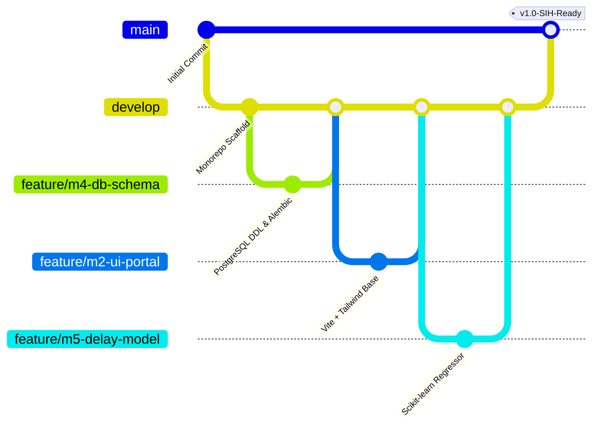

# MPLAD-AI: Git Branching Strategy & Team Workflow
**SIH 2026 Problem Statement ID: 26102 | 6-Member Engineering Team**

---

## 1. Git Branching Strategy (Trunk-Based Development)

We adopt a structured GitHub Flow with a persistent `develop` staging branch to ensure rapid iteration during hackathons while protecting demo stability.



### Branch Responsibilities
1. **`main`**:
   - Production / Hackathon Demo ready.
   - Only receives merges from `develop` via Pull Request after full testing.
   - Always in a working, deployable state.
2. **`develop`**:
   - Primary integration branch where completed features merge.
   - Tested daily by Member 1 (Lead).
3. **`feature/<member-id>-<short-description>`**:
   - Short-lived working branches for specific components or tasks.
   - Examples:
     - `feature/m2-mp-proposal-form`
     - `feature/m3-leaflet-gis-map`
     - `feature/m4-fastapi-auth-rbac`
     - `feature/m5-delay-prediction-model`
     - `feature/m6-duplicate-detection-engine`
4. **`fix/<issue-description>`**:
   - Fast resolution of bugs discovered on `develop` or during integration.

---

## 2. Commit Message Standard (Conventional Commits)

All team members must write descriptive commit messages following the Conventional Commits format:
`<type>(<scope>): <short description in present tense>`

### Types
- `feat`: A new user-facing feature or API endpoint.
  - *Example*: `feat(api): add duplicate work check endpoint in ai_router`
- `fix`: A bug fix.
  - *Example*: `fix(ml): handle zero-division in haversine distance calculation`
- `docs`: Documentation updates or additions.
  - *Example*: `docs(schema): document new inspections geo distance field`
- `style`: Formatting, missing semicolons, Tailwind styling tweaks.
  - *Example*: `style(ui): update color tokens for collector dashboard status badges`
- `refactor`: Code restructuring without changing functional behavior.
  - *Example*: `refactor(db): extract database session dependency into deps.py`
- `test`: Adding or updating unit/integration tests.
  - *Example*: `test(backend): add pytest cases for jwt auth and rbac guards`
- `chore`: Dependency updates, tooling, Dockerfile changes.
  - *Example*: `chore(deps): add scikit-learn and joblib to requirements.txt`

---

## 3. Pull Request (PR) Rules & Review Workflow

1. **Pull Before Branching**: Always run `git checkout develop && git pull origin develop` before creating a new feature branch.
2. **Atomic PRs**: Keep PRs focused on a single responsibility (ideally < 300 lines of changes).
3. **Automated Verification**:
   - Backend PRs must pass `pytest`.
   - Frontend PRs must pass `npm run build`.
4. **Mandatory Approval**:
   - Every PR requires at least 1 approval from a peer or Member 1 (Lead).
   - Schema modifications (`backend/models/`) require explicit sign-off from Member 4 (Database Specialist).
5. **Squash and Merge**:
   - When merging into `develop`, choose **Squash and Merge** with a clean, concise title. This preserves a clean linear history.

---

## 4. Pull Request Description Template

```markdown
## Description
<!-- What does this PR do? Briefly describe the changes. -->

## Member Role & Module
- [ ] Member 1: Gateway & Docker
- [ ] Member 2: Frontend Lead / UI
- [ ] Member 3: GIS & Citizen Portal
- [ ] Member 4: Backend & Database
- [ ] Member 5: ML Predictive Analytics
- [ ] Member 6: ML Anomaly & NLP

## Testing Done
<!-- How was this tested? (e.g. pytest, manual browser testing, curl) -->

## Checklist
- [ ] Code follows project formatting standards.
- [ ] No hardcoded secrets or API keys introduced.
- [ ] Documentation updated if relevant.
```

---

## 5. Team Communication & Daily Standup Cadence

- **Daily Standup (15 Minutes)**:
  1. What did I complete yesterday?
  2. What am I building today?
  3. Are there any blocking dependencies (e.g., waiting for an API contract or schema update)?
- **Handoff Milestones**:
  - **Schema Freeze**: End of Day 2 (Member 4 provides locked SQL DDL & SQLAlchemy models).
  - **Mock API Handoff**: End of Day 3 (Member 1 & 4 provide Postman collection / Swagger mock URLs for frontend).
  - **ML Model Freeze**: End of Day 7 (Members 5 & 6 export `.joblib` model weights for backend embedding).
  - **Final Code Freeze**: 24 hours before demo presentation.
